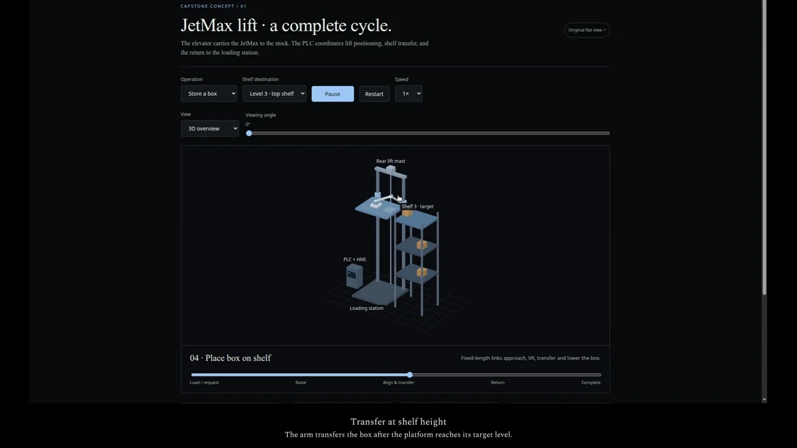

# Elevator storage concept

A browser animation of a robot arm mounted on a lift. A proposed PLC sequence moves the platform to a shelf, transfers a box, and returns to the loading station.

[](https://trylen22.github.io/demos/elevator/)

[Watch the captioned demonstration](https://trylen22.github.io/demos/elevator/). The page also provides the MP4 and subtitle file.

[Open the interactive concept](https://trylen22.github.io/capstone-elevator-storage/).

## Controls

Choose **Store** or **Retrieve**, select a shelf, and play the cycle. The timeline can be scrubbed to inspect individual stages. Speed and view controls make it possible to compare the 3D, elevation, and overhead views.

## Run locally

```bash
git clone https://github.com/Trylen22/capstone-elevator-storage.git
cd capstone-elevator-storage
python3 -m http.server 8000 --bind 127.0.0.1
```

Open `http://127.0.0.1:8000/`. No dependencies or build step are required. `original.html` preserves the earlier flat illustration.

## Model and checks

The renderer uses WebGL depth testing and fixed-length, two-link inverse kinematics. The sequence separates approach, lift, transfer, lower, and retract stages.

```bash
NODE_PATH=/path/to/playwright/node_modules node tests/geometry.cjs
```

The check expects Chrome at `/usr/bin/google-chrome` and writes screenshots under `/tmp/elevator-tests/`. It samples 5,766 poses across storage, retrieval, and three shelf levels, checking link lengths, modeled clearances, stowed travel, and box attachment.

## Scope

The arm dimensions, shelf geometry, and timing are illustrative. This is a concept animation, not a dimensioned JetMax installation or a validated physical control program. Geometry checks apply to the modeled scene and do not establish real robot clearance or machine safety.
